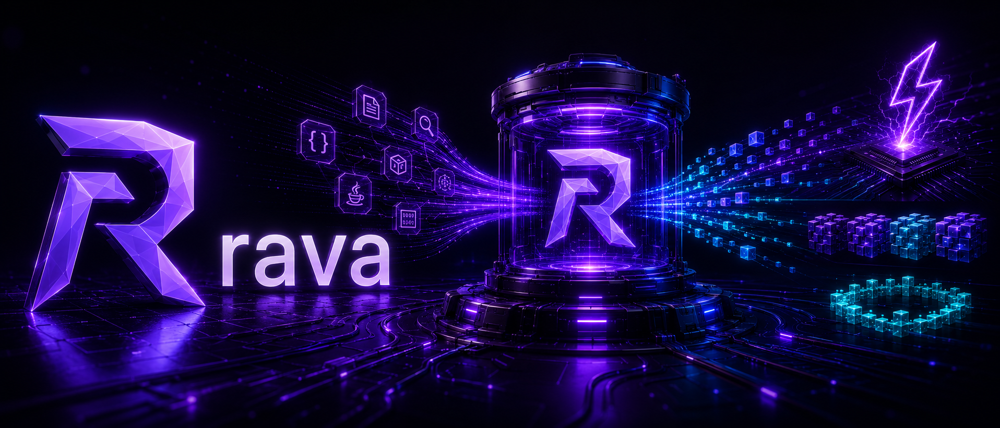
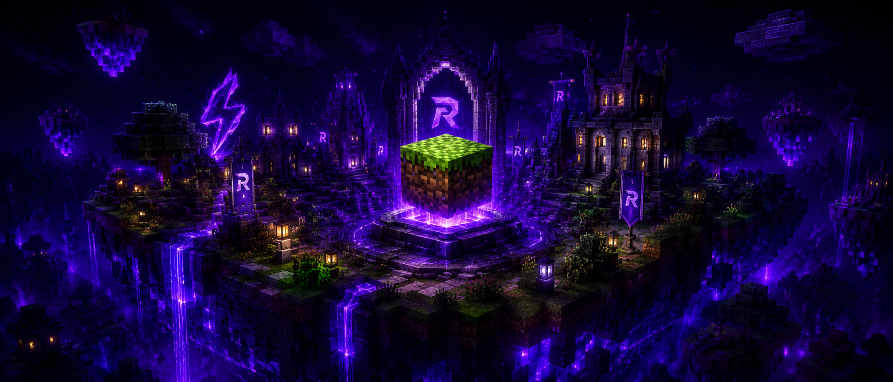
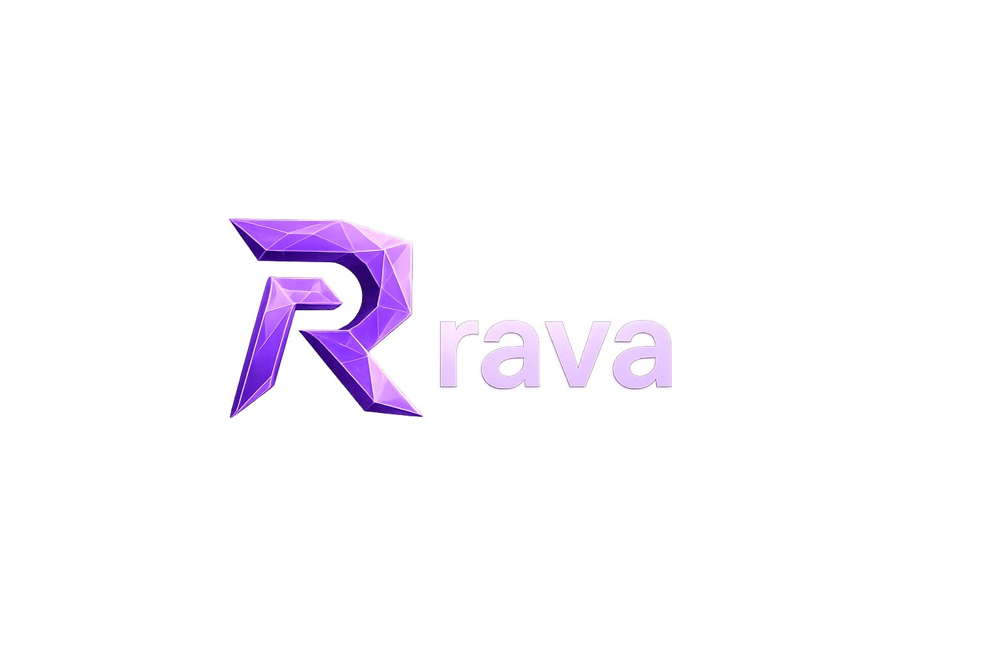

<div align="center">



<h3>A Java virtual machine written from scratch in Rust</h3>

<p>
Self-contained · two-tier JIT to x86-64 · generational GC · the <code>java</code> command line, unchanged
</p>

<p>
<a href="https://github.com/redstone-md/rava/releases"></a>
<a href="https://github.com/redstone-md/rava/actions/workflows/ci.yml"></a>
<a href="LICENSE"></a>
</p>

<p>


</p>

<p>
<a href="#install"><b>Install</b></a> ·
<a href="#usage"><b>Usage</b></a> ·
<a href="#minecraft"><b>Minecraft</b></a> ·
<a href="#how-it-works"><b>How it works</b></a> ·
<a href="#numbers"><b>Numbers</b></a> ·
<a href="#documentation"><b>Docs</b></a> ·
<a href="CONTRIBUTING.md"><b>Contributing</b></a>
</p>

</div>

<br>

rava runs Java programs the way `java` does, with the same command line, output, exceptions
and exit codes. It ships its own copy of the Java class library and implements every native
method itself, so you do not need to install anything else. The main benchmark is a cold start
of a Paper 1.21 Minecraft server. rava brings it up in about 1.2× HotSpot's time, with no
snapshot, no archive and nothing tuned for the server. It also runs the Minecraft client,
vanilla and modded, from the usual launchers.

> [!WARNING]
> **Alpha.** rava runs real servers and games, but expect crashes and differences from HotSpot.
> Keep backups of anything you open with it. Please report problems in
> [Issues](https://github.com/redstone-md/rava/issues).

<br>

<table>
<tr>
<td width="33%" valign="top">

### Two-tier JIT
A baseline compiler emits x86-64 straight from bytecode. An optimizing tier on SSA inlines
by type profile, speculates and deoptimizes.

</td>
<td width="33%" valign="top">

### Generational GC
Size-class pages, bump allocation inline in compiled code, parallel marking, compressed
references and a 32-bit class word.

</td>
<td width="33%" valign="top">

### Drop-in `java`
`-jar`, `-cp`, modules, single source files, `@argfiles`, `-D`/`-X`/`-XX`. Type `rava`
wherever you would type `java`.

</td>
</tr>
<tr>
<td width="33%" valign="top">

### Self-contained
One archive holds the VM and the class library it runs. The machine needs no JDK, JRE or
HotSpot.

</td>
<td width="33%" valign="top">

### Real JNI
Native libraries such as netty's epoll, LWJGL and OpenAL load and run as they do on HotSpot,
at the same call cost.

</td>
<td width="33%" valign="top">

### Cold starts only
There is no class-data archive, no checkpoint/restore, no AOT cache, and nothing keyed to a
program. Every start loads from class files.

</td>
</tr>
</table>

<br>

<a name="install"></a>
<picture>
  <source media="(prefers-color-scheme: light)" srcset="https://gfx.redstone.md/strip?label=INSTALL&note=one%20archive%2C%20no%20JDK&theme=light">
  
</picture>

Download the archive for your system from
[**Releases**](https://github.com/redstone-md/rava/releases) and unpack it anywhere. It is a
complete Java runtime. Each archive has a `.sha256` file next to it. Any x86-64 processor from
about 2009 on (SSE4.2) will do, and rava uses newer instruction sets when the processor has them.

| System | Archive | Requires |
|---|---|---|
|  | `rava-<version>-linux-x86_64.tar.gz` | glibc 2.35 or newer |
|  | `rava-<version>-macos-x86_64.tar.gz` | Intel, or Apple Silicon through Rosetta 2 |
|  | `rava-<version>-windows-x86_64.zip` | Windows 10 or newer |

<table>
<tr>
<th>Linux · macOS</th>
<th>Windows (PowerShell)</th>
</tr>
<tr>
<td>

```sh
tar xzf rava-0.0.1-alpha-linux-x86_64.tar.gz
export PATH="$PWD/rava-0.0.1-alpha-linux-x86_64/bin:$PATH"
rava -version
```

</td>
<td>

```powershell
Expand-Archive rava-0.0.1-alpha-windows-x86_64.zip .
$env:Path = "$PWD\rava-0.0.1-alpha-windows-x86_64\bin;$env:Path"
rava -version
```

</td>
</tr>
</table>

<br>

<a name="usage"></a>
<picture>
  <source media="(prefers-color-scheme: light)" srcset="https://gfx.redstone.md/strip?label=USAGE&note=the%20java%20command%20line&theme=light">
  
</picture>

Wherever you would type `java`, type `rava`:

```sh
rava -jar server.jar --nogui
rava -Xmx4G -XX:+UseG1GC --add-opens java.base/java.lang=ALL-UNNAMED -cp 'lib/*' app.Main
rava -p mods -m app/app.Main
rava Hello.java
rava @options.txt Main
```

<details>
<summary><b>Everything the command line accepts</b></summary>

<br>

The class path comes from `-cp`, `CLASSPATH` or `.`, with `dir/*` wildcards. rava also takes
`-jar`, `-m` and single source files; `-D`, `-ea`/`-da`, `--add-opens` and the other module
options; `-X` and `-XX` options (options for other collectors are accepted and ignored, as
HotSpot does); `@argfiles`; and `JAVA_TOOL_OPTIONS`, `JDK_JAVA_OPTIONS` and `_JAVA_OPTIONS`.
Help, version, `-XshowSettings` and module listings come from the JDK's own launcher classes,
so the output, error messages and exit codes match java's. JVM TI agents (`-javaagent`,
`-agentlib`) are not supported.

</details>

<br>

<a name="minecraft"></a>
<picture>
  <source media="(prefers-color-scheme: light)" srcset="https://gfx.redstone.md/strip?label=MINECRAFT&note=servers%20and%20the%20client&theme=light">
  
</picture>



| | |
|---|---|
| Servers | Paper, Fabric, NeoForge: `rava -jar paper.jar --nogui` in place of `java`. All The Mods 10 starts and ticks. |
| Client | Minecraft 1.20.5 – 1.21.x, vanilla, Fabric and NeoForge, from Prism Launcher or any launcher that lets you pick the Java executable. |
| Graphics | OpenGL through the system driver; `-Drava.opengl=vulkan` renders through Mesa's Zink on Linux. |

In Prism Launcher, set *Settings → Java → Java path* to `bin/rava` from the unpacked archive
(`bin\rava.exe` on Windows). The bundled class library is Java 21's, so versions that require
Java 25 (Minecraft 26.x) do not run yet. See [docs/minecraft.md](docs/minecraft.md) for details.

<br>

<a name="how-it-works"></a>
<picture>
  <source media="(prefers-color-scheme: light)" srcset="https://gfx.redstone.md/strip?label=ARCHITECTURE&note=class%20files%20to%20machine%20code&theme=light">
  
</picture>


rava runs the real class library. `java.base` and the other modules come from the JDK's
`lib/modules` image as ordinary bytecode, the same bytes HotSpot runs. The VM supplies only what
HotSpot supplies: the native methods, `Unsafe`, method handles and threads. `HashMap` is compiled
and inlined like any other code.


Code runs in three tiers. The first is an interpreter. The second is a baseline compiler that
emits x86-64 straight from bytecode, with inline caches and method-handle folding. The third is
an optimizing tier on SSA with linear-scan register allocation, receiver-profile inlining, CHA,
loop-invariant code motion and deoptimization back to the interpreter.

References are raw pointers. A reference is an address, and a field is a load at a fixed
offset (references inside objects are compressed to 32 bits, as in HotSpot). The heap never
moves an object that a stack, a native or the VM holds. Survivors reached only through the heap
move into packed pages, and everything else stays where it is. Natives, the interpreter and
compiled code share objects without handles or stack maps.

One VM runs on all three systems. Memory, faults, threads and libraries sit behind a small
platform layer, and each system's class-library natives live in their own modules. The
compilers, the collector and the object model are shared.

<br clear="all">

<br>

<a name="numbers"></a>
<picture>
  <source media="(prefers-color-scheme: light)" srcset="https://gfx.redstone.md/strip?label=NUMBERS&note=against%20HotSpot%20on%20the%20same%20host&theme=light">
  
</picture>

Both run on the same 4-vCPU Xeon @ 2.1 GHz with JDK 21, in alternating rounds:

| | rava | HotSpot | |
|---|---:|---:|:---|
| Paper 1.21.1, cold start to `Done` | **34.4 s** | 28.5 s | 1.2× |
| Hello world | **92 ms** | 54 ms | 72 ms without HotSpot's class-data archive |
| JNI call, `static int add(int, int)` | **10–13 ns** | 12–15 ns | at parity |
| All The Mods 10 server, resident memory | **7.3 GB** | 8.2 GB | after two tick sprints |

HotSpot's hello world reads a class-data archive. rava never does: every launch starts from
class files. Most of the server gap is world generation.

<br>

<a name="troubleshooting"></a>
<picture>
  <source media="(prefers-color-scheme: light)" srcset="https://gfx.redstone.md/strip?label=TROUBLESHOOTING&note=thread%20dumps%20and%20reports&theme=light">
  
</picture>

When something hangs, rava prints a thread dump the way HotSpot does, with every Java thread,
its state and its stack.

| Linux, macOS | Windows | Without a console |
|---|---|---|
| `kill -3 <pid>` or `Ctrl+\` | `Ctrl+Break` | `RAVA_DUMP_EVERY=30` in the environment |

A useful report includes the output of `rava -version`, the system, how the program was
started and the full output. See [docs/troubleshooting.md](docs/troubleshooting.md).

<br>

<a name="build"></a>
<picture>
  <source media="(prefers-color-scheme: light)" srcset="https://gfx.redstone.md/strip?label=BUILD&note=cargo%2C%20layout%2C%20tests&theme=light">
  
</picture>

You need stable Rust and a JDK 21. The JDK is the reference `java` that the tests compare against:

```sh
cargo build --release          # target/release/rava
tests/check.sh                 # what CI runs: probes, JNI and patches against java
dist/make.sh                   # the release archive: rava with its class library
bench/paper_ab.sh HEAD java    # server start, A/B against HotSpot
```

The same commands work on macOS and on Windows (Git Bash, with MinGW `gcc` for the JNI test).
CI runs them on all three systems for every change.

<details>
<summary><b>Repository layout</b></summary>

<br>

```
crates/rava/       the VM: loader, interpreter, JIT, GC, natives, launcher, platform layer
tests/semantics/   probes whose output must match java's
tests/patches/     a program and a patch exercising every kind of edit
patches/           official patches (rava-patches/ jars, docs/patches.md)
bench/             microbenchmarks, world-generation benchmarks, the server A/B harness
docs/              architecture, the optimizing tier, platforms, guides, release notes
dist/              the distribution build
```

</details>

<br>

<a name="documentation"></a>

## Documentation

| | |
|---|---|
| [Architecture](docs/README.md) | The object model, collector, compilers, natives and launcher, and why they are built that way |
| [Minecraft](docs/minecraft.md) | Servers, the client and launchers |
| [Troubleshooting](docs/troubleshooting.md) | Thread dumps, diagnostics and reporting problems |
| [Optimizing tier](docs/opt-tier.md) | The SSA compiler: inlining, speculation and deoptimization |
| [Java releases](docs/jdk-versions.md) | Which class libraries run and how releases differ |
| [Platforms](docs/platforms-roadmap.md) | The Linux, macOS and Windows ports |
| [Patches](docs/patches.md) | Program-specific changes that the owner installs |

## Rules

- No workload-specific tuning. No path, threshold or policy may be keyed to one application's
  classes, names or outputs. The adaptive machinery every production JVM has (counters, tiers,
  OSR, type profiles, inline caches, speculation with deoptimization) is allowed, and so are
  intrinsics for `java.*` methods.
- No snapshots. Every launch starts from class files, with no heap or class archive, no
  checkpoint/restore and no AOT cache. A cold start is the only start that counts.
- Program-specific changes are patches. Code that knows about one program lives in a patch the
  owner installs in `rava-patches/` ([docs/patches.md](docs/patches.md)), never in the VM.
  Results with patches are reported separately from VM comparisons.

## Contributing

Bug reports, fixes and small programs that behave differently under rava than under `java` are
welcome. Start with [CONTRIBUTING.md](CONTRIBUTING.md).

<br>

<div align="center">



<sub>
Licensed under the <a href="LICENSE">Apache License 2.0</a>. Copyright 2026 Rxflex and the rava contributors.
<br>
Redistributions and derived works must keep the <a href="NOTICE">NOTICE</a> and credit the rava project.
<br>
Release archives also contain the OpenJDK class library, under its own license (GPLv2 with the Classpath Exception).
</sub>

</div>
